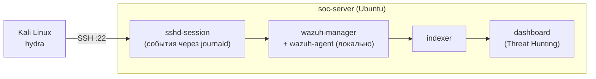
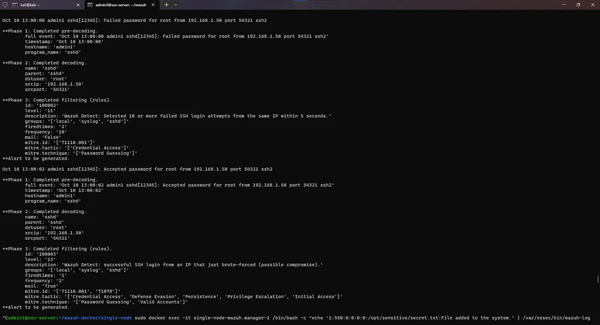
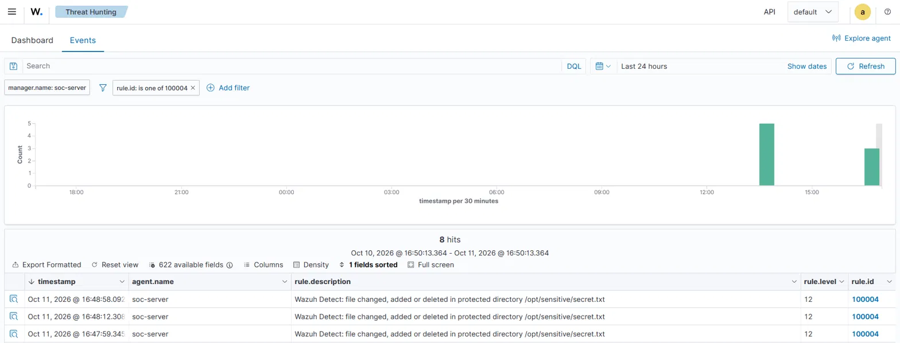
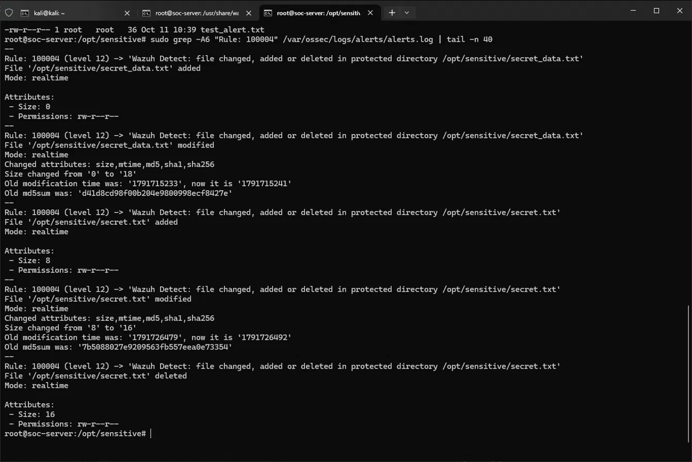

# Wazuh SIEM Lab: детект SSH-брутфорса и контроль целостности файлов

Учебный стенд на Wazuh (нативная установка на Ubuntu): собственные правила корреляции для SSH-брутфорса, успешного входа после брутфорса и изменения файлов в защищаемом каталоге. Атаки генерируются с Kali (hydra) на собственную виртуальную машину. Все три сценария проверены не только на синтетических логах, но и на реальных атаках — ниже настоящие алерты из `alerts.json`.

**Что показывает проект**
- Практическая работа с SIEM: сбор логов, разбор декодерами, написание собственных правил корреляции (XML).
- Привязка детектов к MITRE ATT&CK (T1110.001, T1078).
- Воспроизводимая проверка: `wazuh-logtest` на синтетических событиях + сквозной прогон «атака → алерт» на реальной инфраструктуре.
- Разбор реальной нестабильности порогов: почему первая попытка детекта не сработала и как порог был пересчитан под фактическую скорость атаки.

**Стек:** Wazuh (нативная установка, Ubuntu), Kali Linux, hydra

> ⚠️ Только для обучения: все атаки направлены на собственные ВМ в изолированной сети.

## Содержание
1. [Цель и контекст](#цель-и-контекст)
2. [Топология стенда](#топология-стенда)
3. [Развёртывание](#развёртывание)
4. [Сценарии детекции](#сценарии-детекции)
5. [Связь со встроенными правилами](#связь-со-встроенными-правилами)
6. [Тестирование](#тестирование)
7. [Результаты](#результаты)
8. [Реакция на алерты](#реакция-на-алерты)
9. [Дашборд](#дашборд)
10. [Ограничения и что дальше](#ограничения-и-что-дальше)
11. [Структура репозитория](#структура-репозитория)

## Цель и контекст
- **Контекст:** SSH-сервер подвергается подбору паролей и попытке манипуляции файлами в защищённой директории.
- **Проблема:** исходных правил Wazuh недостаточно для двух задач: быстро заметить всплеск неудачных входов с коротким, подобранным под реальную скорость атаки, окном и отдельно подсветить самый опасный случай, когда после подбора вход всё-таки происходит.
- **Решение:** внедрение трёх собственных правил поверх встроенных (см. [Сценарии детекции](#сценарии-детекции)) и реагирования на их триггер, проверенных и на синтетических логах, и на реальных атаках с Kali.

## Топология стенда



| Хост | Роль | IP | Комментарий |
|---|---|---|---|
| Kali | источник атак (hydra) | 192.168.0.106 | version 2026.2 |
| soc-server (Ubuntu) | sshd, Wazuh manager+agent, indexer, dashboard | 192.168.0.108 | нативная установка all-in-one |

## Развёртывание
- **Wazuh:** нативная установка на Ubuntu (manager, indexer, dashboard одним all-in-one стендом). 

  
  ```
  curl -sO https://packages.wazuh.com/4.14/wazuh-install.sh && sudo bash ./wazuh-install.sh -a
  ```
- **Источник логов:** sshd на этом же хосте пишет через `sshd-session` (современный OpenSSH разделяет процесс на мастер и сессию), события читаются из `journald`; дополнительно подтверждено, что те же строки попадают и в `/var/log/auth.log`.
- **FIM** (`/var/ossec/etc/ossec.conf`, секция `<syscheck>`):
  ```xml
  <directories check_all="yes" realtime="yes">/opt/sensitive</directories>
  ```
  Каталог создаётся заранее (`mkdir -p /opt/sensitive`), конфиг — строка 150 в `ossec.conf`. Подтверждение из `ossec.log`:
  ```
  INFO: (6003): Monitoring path: '/opt/sensitive', with options 'size|permissions|owner|group|mtime|inode|hash_md5|hash_sha1|hash_sha256|realtime'.
  INFO: (6016): Directory set for real time monitoring: '/opt/sensitive'.
  ```
- **Правила:** файл [`rules/local_rules.xml`](rules/local_rules.xml), правится напрямую на хосте через gui интерфейс (`/var/ossec/etc/rules/local_rules.xml`), вне контейнеров. После правки следует либо воспользоваться всплывающим окном на запрос перезапуска wazuh-manager либо выполнить команду `sudo systemctl restart wazuh-manager`.

## Сценарии детекции

| Rule ID | Что ловит | Источник | Порог | MITRE | Уровень | Статус проверки |
|---|---|---|---|---|---|---|
| 100002 | N+ неудачных SSH-входов с одного IP | sshd | 8 за 15 с | T1110.001 | 11 | ✅ logtest, ✅ реальная атака |
| 100003 | успешный вход с IP, только что сработавшего на 100002 | sshd | окно 120 с | T1110.001, T1078 | 13 | ✅ logtest, ✅ реальная атака |
| 100004 | файл изменён, добавлен или удалён в `/opt/sensitive` | FIM (syscheck) | — | T1565.001 | 12 | ✅ реальные события (add/modify/delete) |

<details>
<summary>100002: всплеск неудачных входов</summary>

```xml
<rule id="100002" level="11" frequency="8" timeframe="15">
  <if_matched_sid>5760</if_matched_sid>
  <same_source_ip />
  <description>Wazuh Detect: Detected 8 or more failed SSH login attempts from the same IP within 15 seconds.</description>
  <mitre>
    <id>T1110.001</id>
  </mitre>
</rule>
```
Порог пересчитан по факту: первая попытка (окно 5 с, 10 неудач) не сработала, потому что реальная скорость hydra с задержкой PAM на неудачный вход — около 1 неудачи в секунду, а не одна в доли секунды, как в синтетическом логтесте. 8 за 15 с — рабочий порог для этого стенда. Подробный разбор — в разделе [Тестирование](#тестирование).
</details>

<details>
<summary>100003: успешный вход сразу после всплеска</summary>

```xml
<rule id="100003" level="13" timeframe="120">
  <if_sid>5715</if_sid>
  <if_matched_sid>100002</if_matched_sid>
  <same_source_ip />
  <description>Wazuh Detect: successful SSH login from an IP that just brute-forced (possible compromise).</description>
  <mitre>
    <id>T1110.001</id>
    <id>T1078</id>
  </mitre>
</rule>
```
Правило-надстройка: срабатывает на успешный вход (5715), если с того же IP в последние 120 с сработало 100002. В тесте успешный вход пришёл через 8 с после 100002 — почти мгновенно по меркам 120-секундного окна.
</details>

<details>
<summary>100004: изменения в защищаемом каталоге (FIM)</summary>

```xml
<group name="local,syscheck,">
  <rule id="100004" level="12">
    <if_sid>550,553,554</if_sid>
    <field name="file">^/opt/sensitive/</field>
    <description>Wazuh Detect: file changed, added or deleted in protected directory $(file)</description>
  </rule>
</group>
```
Первая версия с `<match>^ossec: Syscheck...</match>` проверялась только на синтетической строке собственного формата и не соответствовала реальным FIM-событиям — `$(file)` оставался пустым. Рабочая версия — через `if_sid 550/553/554` и `field name="file"`, путь корректно подставляется в описание на реальных событиях (см. [Тестирование](#тестирование)).
</details>

## Связь со встроенными правилами
- `5760` — базовое правило «sshd: authentication failed» (уровень 5), родитель для 100002.
- `5715` — успешный вход по sshd, родитель для 100003.
- На стенде при обычном логине (не атаке) дополнительно наблюдались встроенные правила PAM-сессии (`5501`/`5502`), `unix_chkpwd` (`5557`) и составное `40112` («Multiple authentication failures followed by a success», уровень 12) — встроенный аналог 100003. Отличие собственных правил: явная привязка к MITRE-тегам, короткое перенастраиваемое окно и прямая связь именно с 100002, а не с общим правилом неудачных входов.

## Тестирование

### 1. Правила на синтетических логах (`wazuh-logtest`)
Проверка логики без таймингов: 10 строк `Failed password` подряд и затем `Accepted password` с того же IP.  Результат: серия `5760` → на десятом событии `100002`; на `Accepted password` — `100003`. Подтверждает корректность синтаксиса правил, но не реальные тайминги — все синтетические строки имеют одну и ту же метку времени.

### 2. Разбор реальной скорости атаки
```bash
sudo grep "Failed password" /var/log/auth.log | cut -c1-19 | uniq -c | tail -n 40
```

Результат показал 1–3 неудачи в секунду в обычных прогонах — недостаточно для исходного порога (10 за 5 с). Отдельно был один всплеск с 16 неудачами в одну секунду: это прогон с логином `root`, где все попытки заведомо отклоняются (вход root по паролю запрещён) без задержки PAM, применимой к обычным пользователям — несущая другую, более быструю динамику. Вывод следующий - порог под обычного пользователя нужно считать по его собственной скорости, а не по root-прогону. После пересчёта (8 за 15 с) правило сработало на обычном пользователе `admin1`.

### 3. Реальная атака: Kali → hydra → алерты
```bash
seq 1 20 > /tmp/wazuh_test.txt
echo "1111" >> /tmp/wazuh_test.txt
hydra -l admin1 -P /tmp/wazuh_test.txt -t 4 -V ssh://192.168.0.108
```
При параллелизме `-t 4` часть неудачных попыток пришла почти одновременно (4 события в одну секунду, затем ещё несколько в следующие секунды) — 8 неудач набрались примерно за 3 секунды, уложившись в окно 15 с. Реальный алерт `100002`:
```json
{
  "timestamp": "2026-10-11T13:43:14.897+0000",
  "rule": {"level": 11, "id": "100002",
    "description": "Wazuh Detect: Detected 8 or more failed SSH login attempts from the same IP within 15 seconds.",
    "mitre": {"id": ["T1110.001"]}},
  "data": {"srcip": "192.168.0.106", "dstuser": "admin1"}
}
```
Через 8 секунд, на попытке с паролем `1111`, пришёл `100003`:
```json
{
  "timestamp": "2026-10-11T13:43:22.900+0000",
  "rule": {"level": 13, "id": "100003",
    "description": "Wazuh Detect: successful SSH login from an IP that just brute-forced (possible compromise).",
    "mitre": {"id": ["T1110.001", "T1078"]}},
  "data": {"srcip": "192.168.0.106", "dstuser": "admin1"}
}
```


### 4. FIM: реальные события от агента
```bash
sudo mkdir -p /opt/sensitive
echo "initial" | sudo tee /opt/sensitive/secret.txt ; sleep 10
echo "changed" | sudo tee -a /opt/sensitive/secret.txt ; sleep 10
sudo rm /opt/sensitive/secret.txt
```
Все три операции дали алерт `100004` с корректно подставленным путём:
```
Rule: 100004 (level 12) -> 'Wazuh Detect: file changed, added or deleted in protected directory /opt/sensitive/secret.txt'
File '/opt/sensitive/secret.txt' added        | Mode: realtime
File '/opt/sensitive/secret.txt' modified      | Size changed from '8' to '16'
File '/opt/sensitive/secret.txt' deleted       | Mode: realtime
```

Полный JSON (на примере `modified`) содержит и hash до/после:
```bash
sudo grep '"id":"100004"' /var/ossec/logs/alerts/alerts.json | tail -n 1 | python3 -m json.tool
```





## Результаты

| Сценарий | Ожидание | Получено | Время до алерта |
|---|---|---|---|
| Всплеск неудачных входов (hydra, реальная атака) | 100002 | 100002 ✅ | ~3 с от начала всплеска |
| Успешный вход сразу после подбора (реальная атака) | 100003 | 100003 ✅ | 8 с после 100002 |
| Файл создан в /opt/sensitive | 100004 | 100004 ✅ | почти сразу (realtime FIM) |
| Файл изменён в /opt/sensitive | 100004 | 100004 ✅ | почти сразу |
| Файл удалён в /opt/sensitive | 100004 | 100004 ✅ | почти сразу |
| Active Response: блокировка атакующего IP после 100002 | DROP-правило в nft, 651 | подтверждено (счётчики пакетов + реальный таймаут у hydra) ✅ | ~2 с после 100002 |
| Active Response: снятие блокировки по таймауту | 652 через ~120 с | 652 ✅ | ровно по timeout |

## Реакция на алерты
Реализована автоматическая реакция на правило 100002: Wazuh блокирует IP атакующего через `firewall-drop` и снимает блокировку по таймауту.

```xml
<active-response>
  <disabled>no</disabled>
  <command>firewall-drop</command>
  <location>local</location>
  <rules_id>100002</rules_id>
  <timeout>120</timeout>
</active-response>
```

**Доказательства по трём независимым источникам:**

1. **Алерты.** На срабатывание 100002 менеджер генерирует `651` («Host Blocked by firewall-drop Active Response»), а через ~120 с — `652` («Host Unblocked by firewall-drop Active Response»).


2. **active-responses.log.** Полный цикл виден в сыром логе: `add` → внутренний `check_keys` скрипта → `continue` → `Ended`, а через ~120 с отдельным запуском — `delete` → `Ended`.

3. **Фактическая блокировка пакетов.** `iptables -L INPUT` ничего не показывает — рабочий стол по умолчанию под Ubuntu использует nftables, и правило Wazuh живёт в чейне, которую классическая команда `iptables` не отображает (похоже на управление через ufw/нативный nft, а не через iptables-legacy).

Смотреть нужно так:
   ```bash
   sudo nft list ruleset | grep -B2 <IP_атакующего>
   ```
   До атаки — совпадений нет. После срабатывания 100002 появляется строка вида:
   ```
   type filter hook input priority filter; policy accept;
   ip saddr <IP_атакующего> counter packets 64 bytes 6144 drop
   ```
   Счётчик пакетов/байт растёт по мере того, как атакующий продолжает слать трафик — то есть правило не просто существует, а реально режет пакеты.
    
4. **Эффект на атакующего.** Повторный `hydra` на заблокированный IP в рамках окна таймаута получает:
   ```
   [ERROR] could not connect to ssh://<IP_цели>:22 - Timeout connecting to <IP_цели>
   ```
   В данном случае видна явная связь команд атакующей стороны и срабатывания алертов


## Дашборд


Threat Hunting → Events, фильтр `rule.id: (100002, 100003)` и отдельно `rule.id: 100004` — скриншоты выше.


График количества алёртов в промежуток времени

## Ограничения и что дальше
**Ограничения**
- Порог 8 за 15 с подобран под конкретную скорость атаки (`hydra -t 4` на этом стенде); медленный перебор (low-and-slow, менее 8 попыток за 15 с) правило не поймает.
- Проверка шла без фонового «чистого» трафика реальной инфраструктуры, поэтому ложные срабатывания не оценивались. Возможные источники в проде: NAT (один IP на многих пользователей), опечатки администраторов, сервисные аккаунты с частыми переподключениями.
- Одна целевая ВМ, один узел Wazuh.

## Структура репозитория
```
README.md
rules/local_rules.xml
config/ossec-syscheck-snippet.xml
samples/                               # логи для wazuh-logtest
docs/img/                              # скриншоты 
LICENSE
```
